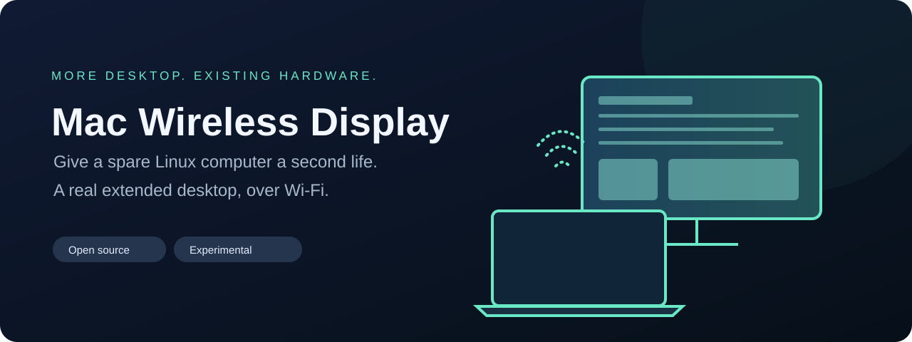
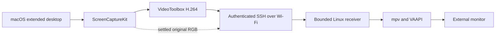

<p align="center"></p>

# Mac Wireless Display

Use a spare Linux laptop or desktop as an **additional display for your MacBook**, over Wi-Fi. Connect a monitor to the spare computer, move a Mac window onto the extended desktop, and keep using your Mac's keyboard and trackpad.

The prototype combines a native macOS virtual display, hardware H.264 encoding, an authenticated SSH tunnel, and hardware decoding on Linux. A small menu-bar app connects and disconnects the display.

**Status: experimental, source-first software.** One additional 1080p display has been tested on an Apple M1 MacBook Air and an older Intel ThinkPad running a Wayland session. It is usable on that setup, but occasional wireless stalls remain. This is not a claim of cable-equivalent latency, calibrated panel colors, universal hardware support, or support for three or four simultaneous remote displays.

## What it does

- Creates a real extended macOS desktop, rather than mirroring your existing screen.
- Sends native 1920 × 1080 video with the pointer included in the capture.
- Uses VideoToolbox on the Mac and VAAPI through mpv on Linux.
- Replaces a settled image with its original lossless RGB snapshot for sharper text and color edges.
- Bounds frame queues and resets damaged decoder streams instead of building an unlimited delay.
- Optionally requests a fresh keyframe after decoder failure, including when the Mac desktop is idle.
- Uses a monochrome menu-bar icon that follows macOS light/dark appearance.
- Keeps video listeners on loopback and carries them through your authenticated SSH connection.

## Start here

1. Read the [requirements and setup guide](docs/SETUP.md).
2. Build the macOS apps locally and install the Linux receiver.
3. Configure an SSH destination that reaches the Linux computer without an interactive prompt.
4. Grant **Wireless Display Host** screen recording permission in macOS.
5. Choose **Connect** in the menu bar, then arrange displays in macOS.

No account with this project, cloud relay, or paid display adapter is required. You still need a working local network and an SSH login to your own Linux computer. A direct Wi-Fi access point can improve some setups, but that configuration is hardware-specific and is not installed automatically.

## How it works



The cursor is captured with the Mac desktop. Input stays on the Mac; this is an extra monitor, not a remote-control login. The Linux computer handles decoding and presentation.

Read the [architecture](docs/ARCHITECTURE.md), [measurement notes](docs/PERFORMANCE.md), and [known limitations](docs/LIMITATIONS.md) before tuning the stream.

## What has actually been measured

The latest recovery-aware comparison reduced median capture-callback-to-presentation time from about **34–39 ms to 28 ms** on the tested setup. The receiver-local median was about **15 ms**. These are software timestamps, not physical mouse-to-pixel latency. Occasional **600–800 ms** stress-test gaps remain; average FPS alone would hide them. A higher-precision sender timer improved sending from about 57 to 60 FPS without improving actual presentation, so it stays disabled.

During matched motion tests, the host, encoder, and menu together used roughly **21% of one CPU core** in the recovery comparison (23–25% in the earlier timer trials). WindowServer was measured separately and cannot be attributed entirely to this application. Power consumption in watts was not measured. The [performance report](docs/PERFORMANCE.md) explains the test conditions and uncertainty.

## Development

```sh
python3 tools/run_tests.py
./tools/build_macos.sh
```

The tests use generated media and fake protocol peers. They do not grant screen permissions, connect to a private machine, or replace a running installation. See [CONTRIBUTING.md](CONTRIBUTING.md) for the review and measurement workflow.

## Roadmap

- Reduce remaining wireless stalls and validate negotiated recovery on more systems.
- Validate quality and resource use on more Mac and Linux GPU combinations.
- Simplify receiver setup and session integration.
- Investigate multiple simultaneous remote displays; only one is supported by this prototype today.

## License and acknowledgements

Apache-2.0. See [LICENSE](LICENSE) and [NOTICE](NOTICE). The private virtual-display declarations retain their original attribution to [Khaos Tian](https://github.com/KhaosT/CGVirtualDisplay), obtained through [DeskPad](https://github.com/Stengo/DeskPad). The receiver uses separately installed [mpv](https://mpv.io/) and your system's VAAPI drivers; they are not bundled here.
